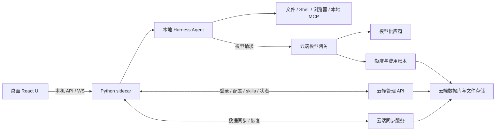

# Octop 桌面 Agent 与云端管理改造计划

> 日期：2026-11-20。状态：P0–P6 功能验收完成；P7 主体实现与本机集成/打包验收完成，Windows/Linux/Intel 等未运行平台及真实 OS 休眠仍待验收。运行库按用户最新要求改为仓库内 vendor 源码依赖，不再推进远端发布。
>
> 本次修订采用「基于 octop-harness 建立新的云端与桌面应用层，选择性迁入 Octop 成熟能力」的路线。本文记录已确认的产品边界，并给出后续实现顺序。勾选项表示实现与验收均完成；尚未验收的探索性代码不计为完成。模块名、接口名和表名是设计建议，实施时结合现有代码确定，不代表已存在。

## 1. 已确认的目标与范围

将 Octop 从服务端承载 Agent 的平台，调整为「云端管理与存储 + 桌面 Agent 执行」。尚未部署，无需兼容旧的完整自托管运行模式，也无需建设旧部署数据迁移工具。

实施方式：在当前仓库建立职责清晰的新应用后端，直接组合 `octop-harness`、`octop-memory` 和 `octop-browser`；沿用现有 Electron 壳与便携包基础；对认证、权限、skills 校验、消息结构等能力逐项审查后迁入。新应用不以旧 `OctopServer`、`AppRuntime`、`AgentManager` 或 Gateway 为启动和调度核心。

| 项目 | 已确认的决策 |
| --- | --- |
| 桌面技术栈 | 沿用现有 Electron + Python sidecar，复用 Python Agent 运行时 |
| 执行位置 | Agent 推理循环、工具调用、本机文件和浏览器操作均在用户桌面执行 |
| 退出与休眠 | 停止或暂停本地执行；云端不接管，不提供持续在线执行保证 |
| 设备范围 | 首期仅单设备，不支持多设备并行运行或会话跨设备接续 |
| 数据同步 | 聊天记录、记忆、工作区内的附件和产物同步云端 |
| 文件边界 | 不自动同步工作区外的本机文件；运行检查点保留本地 |
| 模型调用 | 应用内模型请求全部经过服务端统一鉴权、额度控制与计费；不提供自带 Key 直连模式 |
| 平台资源 | 云端统一发布 Agent 配置和 skills，并分配到用户设备 |
| 个人资源 | 允许本地创建 Agent/skills，并同步为用户个人资源 |
| 修改平台资源 | 创建个人副本后修改；平台更新不覆盖个人副本 |
| 首期排除 | 网页聊天、IM 渠道、定时任务、跨设备或跨用户 Agent 协作 |
| 兼容要求 | 直接面向新架构；不维护旧模式作为第三种产品运行方式 |
| 应用后端路线 | 新建云端与本地应用装配及领域服务，按需复用现有模块；无需另开仓库 |

云端同步不等于云端执行。云端可保存聊天和文件，不运行用户 Agent，也不提供远程工具执行通道。云端仍可提供登录和管理界面，取消网页聊天不等于取消管理后台。

## 2. 当前实现与复用依据

| 当前入口 | 已核实的现状 | 新方案的处理方式 |
| --- | --- | --- |
| `desktop/src/main/index.ts`、`desktop/src/main/supervisor/` | Electron 已管理本地 Python sidecar 生命周期 | 复用进程管理、loopback 访问与打包，补云端登录和同步状态 |
| `desktop/src/main/session/`、`src/octop/api/routers/auth_device.py` | 现有设备凭证用于本机 sidecar 会话续期 | 区分云端账号会话、云端设备身份和本机访问凭证 |
| `src/octop/infra/server.py`、`src/octop/launch.py` | 启动链一起装配管理数据库、Agent、Gateway、Cron 等 | 新建独立应用工厂与启动装配；`launch.py` 仅保留选入口和管理进程生命周期的职责 |
| `src/octop/infra/agents/manager.py` | 同时负责 Agent CRUD、运行实例、工作区、skills 和模型配置 | 作为行为参考，选择性迁入必要校验；本地直接组合 Harness，不整体搬入该管理器 |
| `src/octop/infra/agents/providers/store.py` | Provider 的地址与供应商 Key 被组装成 Harness 配置 | 复用必要的能力描述；重新建立平台模型目录与网关适配，供应商 Key 留在云端 |
| `src/octop/infra/agents/middleware/token_quota.py` | 额度检查发生在 Agent 进程中 | 服务端模型网关成为额度与授权的执行边界 |
| `src/octop/infra/db/repos/usage.py` | 有 Token 用量台账和聚合查询 | 复用用量口径和可独立聚合逻辑，按新合同设计请求级费用账本 |
| `src/octop/infra/history/` | 已有历史消息投影、执行轨迹和对应 repos | 复用适用的消息结构与转换函数，本地聊天直接接收 Harness 事件，不依赖 Gateway 投递 |
| `src/octop/infra/skills/` | 已有包校验、存储和安装能力 | 补发布版本、设备安装回执和个人副本关系 |
| `src/octop/infra/db/services.py`、现有 repos | 聚合现有产品全量数据访问能力 | 选择性复用底层数据库和独立 repo；云端与本地使用各自最小服务容器和 schema |
| `src/octop/infra/bridge/`、Gateway、Cron | 服务原有远程访问、IM 和调度需求 | 新应用不依赖这些模块，不将其改造成同步或本地聊天的基础设施 |

现有 `docs/architecture.md` 和 ADR 描述的是当前单进程实现。后续在对应代码阶段更新这些文档，当前不将目标架构描述为已实现。

## 3. 目标架构与仓库归属

### 3.1 云端

- 负责账号、权限、单设备绑定与撤销、Agent/skills 定义与版本、资源分配、同步数据存储、模型网关和计费。
- 启动时不创建 `HarnessAgentManager`，不启动本地工具执行器、浏览器、IM、Cron、Bridge 或 Agent 调度。
- 管理接口的 CRUD 不得依赖运行中的 Agent 或服务器上的用户工作区。
- 由独立云端应用工厂装配认证、设备、资源、同步、网关与计费；不继承旧 `OctopServer`，不通过给旧启动链逐段增加角色条件来实现新架构。
- 按新合同设计云端最小 schema，选择性复用数据库连接、事务和文件存储能力；不强制新增消息队列、Redis、对象存储或独立微服务。模型网关可作为云端同一进程中的独立领域模块。

### 3.2 桌面

- Electron 负责应用窗口、sidecar 生命周期、系统凭证存储、退出和休眠事件。
- Python sidecar 使用新的本地应用工厂和最小运行服务，直接组合 Harness，负责本地 Agent 生命周期、工具、会话、工作区、记忆，以及云端 API 客户端和同步任务。
- 本地聊天由本机 HTTP/WS 适配直接调用运行服务，将 Harness 事件转换为 UI 消息；不整体迁入 `GlobalProcessor`、Gateway 或旧 `AgentManager`。
- UI 通过 `dashboard/src/api/` 访问本机 API，由 sidecar 调用云端；选择性复用聊天组件和 API 请求工具，按新合同调整客户端，不保留旧接口兼容要求。
- 云端登录会话与本机 API 会话分别管理；云端凭证不作为任意本机 API 的通用信任凭证。
- 本地 SQLite 与云端数据库分别持有自身负责的数据；桌面不直连云端数据库。
- 同步后台任务只在应用存活时运行，不引入用户定时任务或云端 Agent 执行。

### 3.3 修改归属

| 行为 | owning repository / 位置 |
| --- | --- |
| 新云端与本地应用服务、登录、设备、发布分配、同步、网关及计费 | 当前 Octop 仓库，领域逻辑在 `src/octop/infra/`，各自应用工厂和 HTTP 适配在 `api/` |
| Electron 主进程与本机系统交互 | 当前仓库 `desktop/src/` |
| 桌面聊天与管理 UI | 当前仓库 `dashboard/`；不直接编辑 `src/octop/dashboard/` |
| Agent 循环、通用工具执行、模型适配扩展 | `octop-harness`；先复用现有协议，确有缺口再修改该库 |
| 记忆记录导出、恢复、删除、增量变更与索引重建 | `octop-memory`；Octop 只做同步编排与身份映射 |
| 浏览器 CDP、profile、DOM | `octop-browser`；部署到本机不意味着复制实现 |
| IM 协议 | 新应用不依赖 `octop-gateway`；必要的消息转换逻辑审查后独立复用 |

新增领域模块按职责命名；已有 `infra/cloud/` 与 `api/routers/cloud.py` 管理腾讯云 CVM，不复用它们承载本次平台管理功能。依赖方向遵守 `api → infra → repos/utils`，HTTP 与领域仍由 `launch.py` 组合。

### 3.4 新应用边界与代码组织

建议在现有 `src/octop/` 下建立以下逻辑边界，P0 时根据依赖审查确定具体文件名，不额外复制整个 Octop 包：

| 边界 | 职责与约束 |
| --- | --- |
| 云端领域服务 | 认证与权限、设备、Agent/skills 定义和版本、分配、同步存储、模型网关、费用账本 |
| 本地运行服务 | Harness 生命周期、turn 执行、取消与审批、会话投影、工作区、记忆、安装及同步客户端 |
| 共享合同 | 明确版本的请求/响应、事件、资源标识和错误模型；不依赖任一应用的运行实例或数据库容器 |
| 云端 API 工厂 | 仅挂载云端管理、同步与模型接口，使用自己的 DI 容器和生命周期 |
| 本地 API 工厂 | 仅挂载本机聊天、工具审批、工作区、运行与同步状态接口，使用自己的 DI 容器和生命周期 |
| 启动入口 | CLI/Electron 显式选择对应新应用工厂；`launch.py` 管理服务进程启停，不承载领域规则 |

两个应用可以共享小而明确的基础模块；不要创建一个同时拥有云端与本地所有服务的全局容器。云端不能经传递导入拉起本地 Agent、浏览器或工具执行器，本地也不装配云端供应商凭证与费用写入服务。

### 3.5 选择性复用规则

1. **直接复用运行库与桌面基础。** Agent 循环、通用工具、记忆和浏览器继续由各运行库提供；Electron 的进程管理、loopback 中继、系统凭证存储和打包按需接入新 sidecar。
2. **审查后迁入成熟功能。** 密码、Token、认证策略、权限、数据库驱动、skills 校验、消息转换、i18n、时区和 UI 组件需列出依赖、保留行为与对应测试。认证迁入不能静默丢失已保留登录方式的 MFA、禁用或撤销检查。
3. **重新实现应用层。** 启动与 DI、Agent 定义和本地运行服务、设备、版本分配、同步协议、模型网关和结算按新合同设计，不为复用而引入整套旧编排。
4. **有明确成本才扩展共享层。** 能直接使用且依赖合适的函数不重复实现；迁出公共模块时更新实际调用方，避免长期保留两份同义逻辑。
5. **不整体搬入旧路由和 schema。** 旧代码作为需求与测试参考，只有新范围需要的行为才进入新应用；无需旧 URL、旧数据库或旧客户端兼容层。

## 4. 数据归属与同步合同

### 4.1 数据的权威来源

| 数据 | 权威写入方 | 云端或本地副本的用途 |
| --- | --- | --- |
| 用户权限、模型授权、额度、费率、账本 | 云端 | 本地仅展示或缓存，不能自行放宽 |
| 平台发布的 Agent/skills、分配关系 | 云端 | 本地安装并记录实际生效版本 |
| 个人 Agent/skills | 当前绑定设备创建与编辑，云端校验并持久化版本 | 本地先保存，云端确认后显示已同步 |
| 聊天、附件、产物、记忆 | 当前绑定设备 | 云端持久化备份与恢复；不触发 Agent 执行 |
| 检查点、任务控制、设备目录与本机凭证 | 本地 | 不作为普通文件同步到云端 |

每个用户首期只有一个当前有效执行设备。设备重新绑定后，旧设备不能继续发起平台模型请求或上传新数据。重新安装或替换设备可显式恢复已同步数据，但不提供设备间实时接续任务。

### 4.2 同步范围

- 聊天同步线程元数据、稳定消息 ID、消息内容、工具调用与结果关联、附件引用、完成或中断状态；支持同一消息的流式最终更新，不能只追加而忽略更新。
- 记忆同步该用户、该 Agent 的逻辑记录、修订与删除，不复制活跃 SQLite 文件，不导出其他 namespace。优先使用 `octop-memory` 公共接口；接口不足时在该库补齐。
- 文件同步工作区内的附件、产物和个人资源内容，使用相对路径、内容摘要、大小、修订号与删除标记。
- 排除 `.octop/`、旧版 `.octop-auth`、会话数据库、运行检查点、锁、缓存、临时文件、平台或供应商凭证、浏览器 profile 与登录态等系统数据。
- 不能仅凭文件位于工作区就同步整个目录。对支持的同步内容建立明确规则；不跟随符号链接或其他路径跳转读取工作区外文件。
- 用户主动将外部文件作为附件复制到工作区后，该附件纳入同步；工具仅访问外部文件不会自动将整个目录纳入同步。
- 所有 Agent 工作区内容 I/O 通过 `HarnessAgent.workspace` / `BackendWorkspace`；不新增绕过该入口的文件扫描与写入分支。

### 4.3 可靠性与恢复

- 本地先保存数据及待同步记录，再发送；可共用事务的数据应原子落库，文件变更需用内容摘要与扫描水位补偿进程崩溃造成的漏报。
- 本地持久化 outbox，带稳定 `operation_id`、资源 ID、修订号、操作类型和重试状态；云端按用户、设备与操作 ID 幂等接收。
- 云端数据落库后才确认成功。响应丢失、重复发送、进程重启、断网重连不得产生重复消息或资源。
- 更新使用版本校验；删除使用 tombstone，并保留足够的确认信息，避免重试使已删除内容复活。不能把同步窗口内缺少文件误判为删除。
- 云端配置采用修订游标拉取，先安装再回报实际版本；配置拉取和用户数据上传使用各自游标。
- 内容上传完成并校验后，才能发布引用它的文件清单；失败上传不应形成指向缺失内容的成功记录。大文件使用可重试的流式传输，避免整包常驻内存。
- 首期无需 CRDT 或多设备合并。修订不匹配时返回明确冲突，保留本地改动，不能静默覆盖。
- 云端不可用时允许查看本地数据、编辑个人资源并积压同步；由于模型统一走网关，不能启动新的模型推理。
- 恢复必须显式执行，按资源 ID、修订与摘要校验；正常启动不能用云端旧副本覆盖尚未同步的本地数据。
- 已同步聊天可恢复为可查看、可继续新一轮对话的数据；不承诺从云端恢复 LangGraph 检查点或原地续跑中断工具。

## 5. Agent 与 skills 的发布和个人创建

- 分开表示 Agent 定义、发布版本、设备分配与本地运行实例。`enabled` 或配置发布成功不等于设备正在运行。
- 平台资源记录不可变发布版本；设备报告期望版本、已安装版本、运行状态和失败原因。
- Agent 发布版本固定引用所需 skills 的具体版本，不能在同一发布版本内悄悄改变依赖。
- 本地创建时分配稳定公共 ID，先保存个人草稿并同步，服务端验证所有者与个人资源额度。
- 平台资源只能经复制操作生成新的个人资源 ID，保留 `source_id` / `source_revision` 来源信息；个人资源的编辑和删除不修改平台源。
- 更新下载后校验文件清单与摘要，在暂存位置安装，成功后切换版本。安装失败保留上一完整版本；涉及 skills、提示词或模型配置的切换在安全的 turn 边界生效。
- 云端下发权限不能代替本机文件、Shell 或浏览器操作的用户授权，继续使用本地工具审批能力。
- 个人副本继承适用的平台模型授权与额度，不能通过修改 Agent 配置获得额外模型访问权限。

## 6. 模型网关与费用结算

### 6.1 调用边界

- 网关根据已验证的用户与设备会话解析身份，并校验 Agent 所有权或分配关系、模型授权、额度及请求参数。不能信任客户端填写的 `user_id` 或任意供应商 URL。
- 供应商 Key 只存在服务端凭证存储中；客户端模型目录只暴露逻辑模型 ID、能力与平台入口。
- 主模型、子 Agent、压缩摘要、标题生成、记忆提取、Embedding，以及首期保留的其他模型能力统一接入网关；不保留内部辅助调用的直连后门。
- 复用 Harness 支持的模型协议，明确首期实际支持的 Provider 与功能矩阵。覆盖流式文本、工具调用增量、多模态、错误、usage 与取消，不能把所有 Provider 强行当作普通文本接口。
- 服务端只转发模型调用；模型要求的工具由桌面运行，工具结果再进入下一次模型请求。
- 每次模型调用携带可关联的 Agent、线程、turn 与请求标识；一次 turn 可以有多次模型调用，不能按 turn 只结算一次。

### 6.2 额度和账本

- Token 用量沿用输入、输出、缓存读写等现有分项，费用按模型的明确费率版本计算；金额使用固定精度表示，不能使用浮点数累计余额。
- 模型能力矩阵标明可计费的输出上限与用量口径。请求发出前原子预占额度或预算，返回后按真实用量结算并释放余量，覆盖并发请求。
- 费率币种、计价单位、缓存与推理 Token 的包含关系均由配置明确；不得重复计算供应商已经包含在输入或输出中的子项。
- 分开记录逻辑请求、实际供应商尝试与结算记录。同一幂等请求重放不能再次发送供应商请求；重试或切换供应商产生的实际调用分别记录实际费用。
- 客户端断开不代表供应商未消费。网关应在可确认范围内传播取消并独立完成记账；usage 缺失或结果未知进入待核对状态，不能直接记为零或立即无条件释放预算。
- 客户端上报的 Token 仅可用于显示与诊断，不能作为平台扣费的权威来源。
- 本计划的计费范围是用量、费率、额度、费用账本与结算。支付、充值、退款、订阅套餐与开票不在当前已确认范围内。

### 6.3 生产参数

实际供应商与模型清单、币种、单价、额度单位和用量缺失时的核对规则尚未提供。先定义可配置合同并用测试费率验收；这些属于真实计费启用前需要填写的业务参数，不阻塞模块拆分。不得将假定的价格写成生产默认值。

## 7. 生命周期与产品界面

- 退出时停止接收新任务，取消或中断本地 turn，保存可保存的状态，尝试刷新待同步记录；超时后保留 outbox，不能将未确认数据显示为已同步。
- 休眠前尽力保存，唤醒后重新校验云端会话与请求状态；异常中断标记为 interrupted，禁止自动重放可能已有外部副作用的工具调用。
- 本地检查点用于本机恢复，不保证任意 Shell、浏览器动作都能原地续跑。UI 明确区分已完成、运行中、中断和等待用户处理。
- 不要求退出必须等全部大文件上传完成；下次启动继续同步，云端不接管剩余任务。
- 桌面保留聊天、个人与已分配 Agent、skills、工作区、同步状态和用量展示。移除自带 Provider Key、IM、Cron、Bridge 远程聊天及跨设备或跨用户协作入口。
- 云端管理界面保留用户、设备、资源发布分配、模型与用量费用管理；不挂载聊天执行、远程终端、浏览器控制和本地工作区操作路由。
- 同步错误与资源安装错误分别显示，并提供必要的重试或个人副本操作；不向产品用户暴露协议游标等实现细节。
- 继续支持 `zh` / `en`、服务端错误本地化与服务端时区；桌面从云端取得平台时区并供本机 API 与 UI 使用，不改用浏览器本地时区。

## 8. 建议的数据实体和接口边界

以下是实施 P0 需要定稿的合同清单。数据模型按新职责设计，现有实体只在字段、约束和依赖都合适时复用；不要求逐项新增同名表或接口。

| 实体组 | 需要表达的最少信息 |
| --- | --- |
| 设备绑定 | 用户、设备公共 ID、凭证摘要、撤销或绑定代次、最后在线时间 |
| Agent/skills 版本 | 所有者、平台或个人来源、发布版本、来源版本、内容摘要、skills 依赖 |
| 资源分配与本地安装 | 目标用户和设备、期望版本、实际版本、状态、错误 |
| 同步 | 操作 ID、资源公共 ID、修订、游标、删除标记、文件清单及内容引用 |
| 模型请求 | 用户、设备、Agent、线程、turn、幂等 ID、请求状态、实际供应商尝试 |
| 费用 | 费率版本、预占、真实用量、结算金额、释放与待核对状态 |

接口按职责划分为：云端认证与设备、Agent/skills 发布与分配、个人资源写入、同步上传与恢复、模型目录与调用、用量费用查询；本机 API 提供聊天、工具审批、工作区、运行状态与同步状态。

接口应有明确请求/响应模型、权限、版本、幂等和分页规则。云端资源读写按用户隔离，设备只能访问被授权的数据；全局内容摘要相同不能成为读取其他用户文件的凭据。

数据库实现沿用 SQLite/PostgreSQL 双 SQL 迁移和公共字符串 ID 约定。本地使用 SQLite，云端继续支持两种数据库；两端各自初始化所需 schema，不将旧全量 `RepoBundle` 或完整旧 schema 作为启动前提。P0 固定两套 schema 的迁移归属和发现规则；新迁移集合与旧集合明确隔离，不删除或改写现有迁移历史，也不提供旧数据库升级到新产品的数据迁移工具。

## 9. 分阶段实施计划

依赖顺序：`P0 → P1 → P2 → P3 → P4 → P5 → P6 → P7`。每阶段形成可评审的有限改动，先完成该阶段验收，再推进下阶段。P1 先建立新应用入口和最小本地执行链，P2–P5 逐项迁入或实现业务能力；旧实现作为参考与待退役代码，不继续扩展成最终产品的启动核心。

### P0：固定合同、最小 schema 与复用清单

- [x] 建立能力迁入清单，为认证、权限、skills、历史、用量、数据库和 UI 分别标注直接复用、迁入调整、重新实现或排除，并记录依赖与测试。
- [x] 固定新云端/本地应用工厂、DI 容器、共享合同和启动入口的代码位置，明确禁止依赖的旧编排模块。
- [x] 设计云端与本地最小 schema，固定各自迁移集合和初始化方式，不依赖旧全量管理数据库。
- [x] 定稿身份、单设备绑定、Agent/skills 修订、分配、个人副本、同步范围和错误合同。
- [x] 定稿消息更新、文件删除、记忆修订、恢复语义及模型请求/结算状态机。
- [x] 检查实际安装的 Harness 模型协议、workspace API 和 Memory 公共导出/变更接口；列出必须在对应库完成的缺口。
- [x] 确定首期 Provider 功能矩阵与费率配置字段；不自行补入未确认的支付或套餐功能。
- [x] 审查按旧原地拆分路线起步的工作区改动，将可复用部分映射到新边界；未经验证不标记完成，不自动撤回或覆盖其他正在进行的改动。

验收：形成能力与依赖清单、应用边界、schema 与接口合同；完整描述「登录 → 获取 Agent → 本地执行 → 云端模型调用 → 数据同步」以及中断、重试与个人副本。每项迁入能力有明确来源与测试，运行库缺口有对应仓库和前置修改。

P0 验收记录（2026-11-19）：合同与能力清单见 [docs/desktop-cloud-contracts.md](docs/desktop-cloud-contracts.md)，其中 §2.1–2.3 固定新应用边界、schema 和旧改动处理方式，§3–6 固定资源/同步/结算及运行库前置条件。已核实实际安装版本；Memory 的完整快照、增量删除和 Harness 的安全枚举/流式文件能力保留为 P5 前置工作，不宣称已实现。上一轮 27 个失败在补齐本机缺失的 socksio 后逐项复验全部通过（`uv run pytest --lf --tb=short -q`，27 passed）；这不替代 P1 新实现的全量验收。

### P1：建立独立应用入口与最小本地 Harness 运行链

- [x] 新建云端应用工厂与最小服务容器，提供健康检查、配置和独立数据库初始化，启动不导入旧 `OctopServer`、`AppRuntime` 或 `AgentManager`。
- [x] 新建本地应用工厂与运行服务，直接使用 Harness 的公开接口管理 Agent、流式 turn、取消与工具审批，按需接入 Memory 和 Browser。
- [x] 使用测试配置与模型 stub 验证「创建本地实例 → 模型事件 → 本地工具 → 后续模型事件」，明确该测试配置不能成为生产直连路径。
- [x] 新建本地 HTTP/WS 到运行服务的薄适配，复用必要的消息转换函数，不依赖 Gateway、`GlobalProcessor` 或 IM 消息投递。
- [x] 在 `launch.py`、CLI 与 Electron 启动参数中接入两个新工厂，固定命令、配置与关闭语义，不增加旧完整服务作为第三种运行方式。
- [x] 为两端分别注册路由、DI、健康检查与生命周期；云端没有聊天执行路由，本地没有费用写入和供应商密钥管理路由。
- [x] 按两端依赖更新 `pyproject.toml` 与便携包构建；共享的协议/数据类型不应传递导入本机执行器。

验收：两个新应用可从干净目录独立启动与关闭；云端在缺少本地执行依赖时仍可导入和启动；本地通过 API 和模型 stub 完成流式工具闭环及取消。导入/依赖测试证明两端不依赖旧编排模块，错误侧的接口未注册。认证、资源发布和真实平台模型调用分别在 P2–P4 验收。

P1 验收记录（2026-11-19）：

- 实现：`api/applications/{cloud,local}.py` 与 `infra/applications/` 是独立工厂和容器；新增各自迁移集合、水位与本地实例/线程/turn repo，不依赖旧全量 schema。共享合同不导入运行库。
- 启动：`uv run octop-cloud`、`uv run octop-local`，或显式 `octop run --role cloud/desktop`；默认数据目录分为 cloud/local。Electron 调试参数 `--local-runtime` 接入新 sidecar 并生成本机随机凭证；默认产品 UI 按 P6 切换，没有把旧 UI 兼容当作 P1 交付。
- 运行：直接使用真实 Harness，验证了读取本地文件的模型/工具闭环、写入前审批、同 turn 审批继续、活动调用取消、取消审批后的新任务无旧写入副作用，以及重启后的中断状态恢复。WS 使用 Bearer 握手头，凭证不放进 URL。
- 独立安装：两个全新临时虚拟环境分别执行 `uv sync --frozen --no-dev --extra cloud` 与 `--extra local-runtime`。云端未安装四个执行库或 LangChain，启动与关闭成功；本地未安装 Gateway，真实 Harness + stub 工具闭环成功。没有开放生产直连测试配置。
- 后端：`make all` 通过，5955 passed、45 skipped；最终 WS 专项 `uv run pytest tests/integration/test_independent_applications.py -q --tb=short` 为 9 passed。格式、Lint 和全量 mypy 通过。跳过项按仓库环境/平台标记处理。
- 数据库：独立 PostgreSQL 17 测试容器下，`uv run pytest tests/unit/db/test_application_migrations.py -q --tb=short` 为 3 passed，覆盖 SQLite 回滚/水位与 PG 双 SQL 初始化/外键；另实测云端 PG 工厂启动、健康检查和关闭。测试 schema 与容器在验证后清理。
- 前端/壳：Dashboard `npx tsc -b` 与 `make build-frontend` 通过；Electron 在 Node 24.18.0、pnpm 12.15.0 下 `typecheck`、`test`（195 passed）、`build` 通过。未声称验证了 Windows/Linux 原生安装器或完整产品 UI，这些仍在 P7。
- 当时暂停位置：用户要求完成 P1 后暂停，彼时 P2 未开始；本轮已另行授权并完成 P2。P1 云端仅有基础配置、数据库、健康与可选文档，登录/设备属于 P2，真实模型网关属于 P3，Agent/skills 管理与发布属于 P4。Memory 与 Browser 的业务接入仍按后续阶段推进。

### P2：云端登录与单设备授权

- [x] 按 P0 清单迁入账号、密码、Token、所选登录方式与权限校验，使用新云端容器和身份表，不依赖旧全量路由或服务启动。
- [x] 增加云端设备注册、续期、撤销和重新绑定；登录及撤销链有独立测试，不只复用成功登录路径。
- [x] Electron 主进程安全保存云端长期凭证，sidecar 获得所需短期授权，保持本机凭证与云端凭证隔离。
- [x] 为后续模型与同步接口提供按绑定代次校验的统一事务鉴权入口；旧设备被替换后不能再取得写入或额度授权。实际网关/同步接口分别在 P3/P5 接入。
- [x] 按账号隔离本地数据库、工作区及后续 outbox 的存储边界；退出或切换账号不删除未同步数据，后台授权要求匹配原账号与绑定。outbox 表与上传任务在 P5 实现。

验收：登录与应用重启后的续期正常；退出、撤销、禁用用户和重新绑定均生效；本机未授权请求、跨用户资源访问及旧设备写入被拒绝。

P2 验收记录（2026-11-19）：

- 登录方式：用户确认首期为账号密码 + TOTP MFA（含恢复码）；不迁入 SSO、LDAP 或 Passkey。复用现有 Argon2 密码策略、TOTP 原语、恢复码生成/规范化及 Fernet，保留重放防护、失败锁定、禁用和撤销校验。MFA 包旧服务按需导出，避免纯原语加载旧 SharedServices。
- 云端：`infra/identity/`、独立身份 repo 和云端 v2 双 SQL 迁移，挂载新的认证/用户/设备路由。P1 已可初始化 v1 数据库，因此新增 002 并保留 001。通过 `octop-cloud-init` 交互初始化首个管理员，没有公共抢注管理员接口；新 schema 不引入旧全量容器。
- 凭证：随机不透明 Token 按 account/device/challenge 分用途，云端只保存摘要；账号 15 分钟、设备 access 5 分钟、设备 refresh 30 天绝对有效期。设备绑定/替换使用行锁与递增 generation，密码/MFA/账号状态变更撤销已有授权。公开 `authorized_device` 事务边界供 P3/P5 使用，未提前实现模型网关或同步写入。
- Electron：新增独立云端会话客户端与受来源校验的 IPC；长期凭证复用 safeStorage 加密，无 keychain 时仅驻内存，renderer 不取得云端 Token。sidecar 只接收经云端复核的短期设备授权；本机 HTTP/WS 凭证独立注入，renderer 不能通过普通中继调用凭证控制路径。
- 本地：按 cloud origin、云端实例 ID 与 user_id 选择独立账号目录，数据库和 Harness 工作区随账号隔离；切换/退出中断活动 turn 并关闭旧实例，旧 WS 不能进入新账号。保留原账号文件；后台取授权必须携带并匹配原账号身份，不能将旧账号任务授权给新账号。
- 退出：本地解除账号与清除长期凭证优先；云端不可达时明确返回撤销未确认（`revoked=false`）。若 sidecar 解除失败，主进程停止 sidecar 后报告失败。已打开账号可离线查看；冷启动首次选择账号需要在线验证，离线冷启动体验留待数据恢复/产品阶段。
- 后端：最终 `make all` 通过，5971 passed、55 skipped；随后 `make lint typecheck` 与最终身份/CLI/i18n 专项（107 passed、10 skipped）通过。跳过项含无 PG 环境时的参数化用例，PG 实例下已单独实测；mypy 覆盖 715 个源文件。
- 数据库：PostgreSQL 17 临时实例下，身份 + 迁移专项为 24 passed，覆盖 SQLite/PG 两种事务、MFA、并发绑定、撤销与本地账号隔离。云端-only 全新虚拟环境完成密码/MFA/恢复码/设备绑定/重启续期，未安装 Harness、Memory、Browser、Gateway 或 LangChain。
- 联调：用 Node 执行 Electron 主进程云端会话客户端，连接两个真实 HTTP uvicorn 新应用，完成 MFA 登录 → 绑定 → sidecar 选择账号 → 续期 → 退出撤销。Electron `typecheck`、`test`（205 passed）和 `build` 通过；Dashboard `npx tsc -b`、`make build-frontend` 通过。安全存储测试使用注入 cipher 验证策略，完整 GUI/OS keychain 和原生安装器的跨平台手工验收仍在 P7。
- 文档：[docs/cloud-identity.md](docs/cloud-identity.md) 记录启动、路由、凭证期限、IPC、隔离和离线退出语义；API 文档与 OpenAPI 的 summary/schema/Bearer 定义已核对。产品登录页面在 P6；P2 验收时 P3 及后续阶段未开始，当前 P3 进度见下文。

### P3：模型网关、额度与结算闭环

- [x] 在新云端服务中实现模型目录、授权、逻辑路由与供应商凭证存储，迁入适用的模型能力描述和用量口径，不依赖旧 Agent 的模型工厂。
- [x] 实现流式调用、工具调用、多模态及首期辅助模型接口，传播取消并保留最终用量信息。
- [x] 实现请求幂等、供应商尝试记录、原子预占、费用结算、释放与待核对状态。
- [x] 将新本地运行服务的主调用和辅助调用接入平台入口；生产配置只接受平台模型目录与短期授权，不迁入自带 Provider Key 的设置和直连路径。
- [x] 迁入适用的用量聚合逻辑，基于新账本向管理员和用户提供各自可见的费用结果。

验收：使用可计数的供应商 stub 完成本地「模型 → 工具 → 模型」闭环；并发额度不超额，幂等重放不新增上游调用；断流、取消、未知结果和 failover 不丢账或重复结算。客户端无法越权指定模型或修改账本。

P3 验收记录（2026-11-19）：

- 云端：新增 `infra/models/`、独立 model repo 与 cloud v3 的 SQLite/PostgreSQL 双 SQL 迁移，接入新云端容器；P2 已可建立 v2 数据库，因此新增 003，另测 v2 身份记录升级后保持不变。不使用旧 Agent 模型工厂或全量服务容器，云端仍不导入 Harness、Memory、Browser 或 Gateway。
- 管理与授权：管理员账号会话配置供应商、密封 Key、逻辑模型、不可变费率版本、路由、用户模型授权和绝对预算；目录只向用户暴露逻辑模型与能力。设备会话不能修改授权或账本。当前设备登记个人 Agent/thread/turn 的不可重挂关联，消费时验证所有权；正式平台 Agent/skills 发布、版本与分配仍由 P4 接入，不能把消费上下文登记当成平台资源授权。
- 协议：支持 OpenAI Chat Completions、OpenAI Responses、Anthropic Messages 的 JSON/SSE、文本、图像请求、函数工具增量、usage 与取消，以及独立非流式 Embedding。三种生成协议均经实际两个 uvicorn 监听端口、真实 Harness 和可计数供应商 stub 跑通「模型 → 本地 read_file → 模型」。首期不声明 Bedrock、音视频、供应商托管工具或远端 Responses 会话；Anthropic 缓存仅默认/5 分钟 TTL。
- 账本：逻辑 request、实际 attempt 与唯一 settlement 分开保存。服务端当前设备校验和预算预占共用事务；规范化请求摘要与稳定 request_id 防重复消费，重放返回 202 状态，不重放流。输入与输出上限用于保守预占；输入/缓存读/缓存写/输出分项互斥，reasoning 不重复收费；金额按整数 nano 计算，按不可变费率快照结算。
- 未知消耗：仅配置为明确无费用的 HTTP 状态才释放并 failover，默认此列表为空。断流、取消、未知 HTTP/usage 或超出已配置模型用量上限时保留预算并转入 `reconciliation_required`；管理员凭供应商依据核对，保存核对人、依据和权威用量，重复核对不重复结算。180 秒 lease/30 秒心跳及恢复扫描覆盖进程中断；HTTP handler、供应商调用与账本清理各有生命周期，重复取消不会抛弃已开始的事务。完整校验 SSE 事件后才转发，分片的供应商错误内容也不会提前透出。
- 本地：按账号装配平台目录和私有 loopback 模型中继，复用 Harness 的公开 factory/base_url/headers/session_header；SDK 禁止自动重试，输出上限按平台设置。每次模型 HTTP 调用生成独立 request_id，关联本地活动 turn，发送前取得原账号最新短期授权；云端 Token 不放进 SDK 配置。主调用及使用同一 factory 的内部辅助调用走同一网关；显式辅助入口支持 summary/title/memory/subagent/embedding 等 purpose，自动 Harness 调用统一标记 chat。退出、切换账号中断旧流；额度错误保持原 ErrorCode 返回桌面。
- 费用查询：云端提供本人或管理员指定用户的预算、请求/attempt 状态和按模型/币种汇总的已结算费用；sidecar 提供仅当前账号的查询入口。首期不启用支付、充值或完整记忆/标题生成产品；默认没有供应商、费率、消费授权或预算，生产参数仍需部署方填写。
- 后端验收：最终 `make all` 通过，6003 passed、82 skipped，Ruff/格式与 mypy（723 个源文件）通过。`uv run pytest tests/integration/test_platform_models.py tests/unit/models tests/unit/db/test_application_migrations.py -q -x --tb=short` 专项为 34 passed、28 skipped；全量跳过项按环境、平台及 Embedding 非流式合同处理。
- 数据库验收：临时 PostgreSQL 17 实例下，`uv run pytest tests/integration/test_platform_models.py tests/integration/test_cloud_identity.py tests/unit/db/test_application_migrations.py tests/unit/models -q --tb=short` 为 81 passed、2 skipped；覆盖两种数据库的并发预占、幂等、费率快照、failover、核对、设备撤销、取消与账本恢复。两个跳过项为 Embedding 流式组合。测试 schema、容器和临时凭证均已清理。
- 安装与界面边界：仅安装 cloud extra 的全新隔离环境，未安装四个执行库或 LangChain，实际验证模型调用、幂等重放与结算。Dashboard `npx tsc -b`、`make build-frontend` 通过；未修改 Electron 源码。Scalar HTML 及 OpenAPI summary、类型、鉴权与原生 JSON/SSE 响应定义已检查；本次 Playwright driver 未就绪，未完成浏览器渲染抽查。完整产品 GUI、OS keychain 和各平台原生安装器仍在 P7 验收范围内。
- 文档与暂停点：[docs/platform-models.md](docs/platform-models.md) 记录配置顺序、协议矩阵、金额单位、保守预占、异常结算、接口与桌面接入限制；P2 文档与合同已同步更新。P3 验收时停在 P4 之前，未提前实施资源发布/安装或 P5 同步；登录、模型管理及费用产品页面仍在 P6 接入。

### P4：Agent/skills 发布、分配与个人资源

- [x] 基于新资源 schema 实现 Agent/skills 定义、个人资源 CRUD、平台版本发布与设备分配，管理操作不调用 Harness；固定 Agent 所引用的 skills 版本。
- [x] 迁入 skills 包路径与内容校验、必要的安装能力，并为新版本存储编写适配；不搬入绑定旧服务器工作区的管理流程。
- [x] 桌面拉取、校验、暂存、安装并报告实际生效版本，在 turn 边界切换运行配置。
- [x] 实现本地个人创建、同步与编辑，以及平台资源复制为个人资源的操作。
- [x] 安装失败保留上一个完整版本，个人副本不随平台源更新而被覆盖。

验收：管理员发布后目标设备可运行指定版本；未分配用户无法获取资源；本地创建可上传为个人资源；平台更新、重复拉取与安装失败均不破坏个人修改或当前完整安装。

P4 验收记录（2026-11-19）：

- 云端：新增 `infra/resources/` 合同与领域服务、SQL-only resource transaction 和薄 HTTP 适配。cloud v4 / local v2 各有 SQLite/PostgreSQL 双 SQL 迁移，保留前期身份与账本记录，另外验证 v3/v1 升级及重复初始化；不装配旧服务器或 Agent 管理器。
- 发布与分配：资源定义、不可变修订、发布状态、设备分配和实际回执分开保存。平台草稿需显式发布再分配，Agent 固定 skills 的具体已发布修订；发布不会暗中更新已有分配。分配绑定当前设备及 generation，替换设备不继承旧分配。删除写入 tombstone，历史版本和消费账本保留。
- 权限与个人资源：管理员账号会话负责平台发布/分配，当前设备负责个人 CRUD。服务端在身份事务内核对所有权、修订、幂等 ID 与资源额度；不能通过相同摘要、任意资源 ID 或设备会话取得其他用户内容。平台修改必须新建个人 ID，记录来源；复制 Agent 会生成稳定 ID 的个人 skills 快照，源更新或撤销不覆盖已接受的个人副本。
- 消费关联：共享平台定义和账号内本地运行实例分别标识，避免不同用户共用同一个消费 Agent ID。P3 登记、预算预占及 dispatch 前检查正式资源所有权/当前设备分配；消费上下文记录本身不再能作为授权依据。配置不能提供供应商 Key、本机路径或降低工具审批要求。
- skills：直接复用现有 `skill_packages.py` 的规范化，再校验清单/单文件摘要、UTF-8 manifest、跨平台路径、大小写/Unicode 规范化冲突与文件/目录碰撞；不使用旧工作区 Store。旧 `SkillPackageStore` 改为按需导入，使纯校验不引入 Harness。首期为有界文件清单：单 skill 最多 256 文件、合计 4 MiB，Agent 最多 32 个固定依赖，两端 JSON 包络最多 8 MiB；个人最多 100 个有效资源及 64 MiB 云端历史内容，删除不受存储额度耗尽阻碍。
- 桌面：账号内持久化草稿、不可变包缓存、资源 outbox 与配置游标，先落库后上传；稳定 operation ID 覆盖响应丢失与重启，冲突保留本地内容而不静默覆盖，干净本地副本可应用云端 tombstone。正常拉取不自动恢复新安装上的个人资源，`restore_personal=true` 为显式资源恢复。后台任务只同步资源，不是用户定时任务；聊天、文件和记忆 outbox 仍在 P5。
- 安装：通过 `HarnessAgent.workspace` 将固定 skills 写入新的系统暂存树并逐文件回读，完整成功后事务切换运行配置/安装快照；失败保留旧实例与完整目录。运行中或等待工具审批时延后，新 turn 开始前再应用；原审批继续使用原版本。保留工作区和检查点，不自动重放旧任务。退出/撤销停止资源授权与传输，等待在途转换后关闭数据库，异步退役避免安装/模型回调自等待。
- 联调：除 stub 下的发布安装、个人 CRUD/复制、离线/响应丢失/重启、删除/并发额度、损坏下载和安装失败、运行/审批边界与撤销外，两个真实 uvicorn 监听端口验证了已分配平台 Agent 的实际 Harness/SDK「模型 → 本地 read_file → 模型」和两次独立结算；未使用真实付费供应商。
- 后端验收：最终 `make all` 通过，6054 passed、103 skipped；Ruff/格式与 mypy（731 个源文件）通过。最终资源与包专项 `uv run pytest tests/integration/test_platform_resources.py tests/unit/resources -q -x --tb=short` 为 49 passed、21 skipped；跳过项为未设置 PG 环境的参数化用例，已另行实测。身份、模型、独立应用、迁移与 i18n 的组合回归另有 182 passed、57 skipped，之后新增的删除/额度和 Unicode 碰撞用例均已纳入最终全量检查。
- 数据库与隔离验收：临时 PostgreSQL 17 下 `uv run pytest tests/integration/test_platform_resources.py tests/integration/test_platform_models.py tests/integration/test_cloud_identity.py tests/unit/db/test_application_migrations.py tests/unit/resources -q -x --tb=short` 为 147 passed、2 skipped，含 SQLite/PG 两种数据库；两个跳过项为 Embedding 流式组合。仅安装 cloud extra 的全新环境没有 Harness、Memory、Browser、Gateway 或 LangChain，实际完成发布、分配、固定依赖下载、实例授权与 schema/OpenAPI 检查；测试 schema、容器及临时凭证已清理。
- 前端与文档：仅增加错误码的 zh/en 文案，Dashboard `npx tsc -b`、`npm run lint`（0 errors、75 条现有 warnings）和 `make build-frontend` 通过；未修改 Electron 或产品页面。Scalar HTML、OpenAPI 的 summaries、请求/响应类型及鉴权已检查；本轮未宣称完成 GUI 渲染、OS keychain 或原生安装器验收，Linux/Windows 实机/CI 与产品集成仍按 P7 验收。配置与接口见 [docs/platform-resources.md](docs/platform-resources.md)，身份、模型和共享合同文档已同步更新。
- 暂停点（P4 验收时）：P4 完成后停在 P5 之前；当时 P5–P7 尚未开始。当前 P5 的候选包验收及 P6 记录见下节，P7 当前状态见下节。

### P5：聊天、文件与记忆可靠同步

- [x] 实现持久化 outbox、云端幂等接收、游标、修订校验、删除标记与重试。
- [x] 将新本地运行服务的消息投影与附件数据接入同步，复用经过审查的序列化逻辑，支持工具调用关联、流式消息最终更新和中断状态。
- [x] 通过 workspace 抽象同步约定文件，验证摘要、路径及排除规则，补偿崩溃时漏记的文件变更。
- [x] 通过 Memory 公共接口同步逻辑记录、修订与删除；确需扩展时先在 `octop-memory` 完成，不复制该库实现。
- [x] 实现显式恢复与完整性检查；恢复记忆时按库能力重建本地索引，不上传整个活跃数据库。

验收：断网、响应丢失、重复提交、乱序、重启和删除重试后数据一致；未同步内容不被旧云端数据覆盖；外部文件、凭证和检查点未被上传；恢复后聊天、文件、记忆及引用关系完整。

P5 实施记录（2026-11-20，候选包验收完成，发布待执行）：

- 归属：Octop 实现 `infra/sync/`、独立 sync repos、薄 HTTP 适配与 cloud v5 / local v3 双 SQL；文件安全/分片接口在 `octop-harness-p5` worktree，记忆逻辑变更/恢复在 `octop-memory-p5` worktree。原有运行库 checkout 未修改，未编辑已安装包源码。
- 可靠性：本地消息投影与 outbox 同事务，首次发送后请求体和 operation ID 不变；未发送流式更新合并，避免逐 token 全量快照膨胀。云端在身份事务内确认修订、内容和幂等回执，支持删除、响应丢失和重启重试；原绑定未确认写入在绑定变化后保留为冲突。
- 文件：明确只同步 `inbound/` 和 `artifacts/`，排除系统/凭证/检查点/缓存等；通过 workspace 公共接口 no-follow 枚举及分片读写，验证 NFC/大小写、大小和 SHA-256。分片与历史附件按用户隔离；不完整扫描不推进删除水位。
- 记忆：通过新 Memory 公共接口捕获持久化修订/删除，覆盖 tree、episodes、digests 等逻辑类型，不复制活跃数据库或运行 metadata。恢复前排空 Harness 记忆写入，之后由库事务恢复并重建索引；候选支持 SQLite/PostgreSQL。
- 恢复：显式固定 watermark，未同步本地内容跳过；失败/中断保留恢复屏障，显式重试完成。保留运行实例 ID、重新安装固定 skills；没有有效定义/分配时恢复为禁用归档。规范化聊天仅在下一次用户新 turn 时补入 Harness，不恢复云端检查点或重放旧工具。
- 限制：1 MiB 分片/单逻辑记录、256 MiB 单文件、每用户 2 GiB 内容预留及 128 MiB 历史元数据；删除保留历史。新本地开启逻辑记忆存储/捕获/工具，不新增自动提炼策略或向量索引；产品页面和 Electron 退出/休眠接入仍在 P6。
- 发布准备：用户要求额外准备运行库正式发布，目标版本 Harness 1.0.12、Memory 1.0.6；各自源码、测试、说明、版本及 wheel/sdist 已准备；已校验候选包内容与源码一致，并完成安装候选 wheel 的应用验收。尚未提交、推送、打 tag、发布 PyPI 或修改 Octop 的正式依赖锁定。现有锁文件仍指向旧运行库；接口不足时明确返回 `LOCAL_RUNTIME_UPGRADE_REQUIRED`。实际合同见 [docs/platform-sync.md](docs/platform-sync.md)。
- 后端：安装实际 Harness 1.0.12 / Memory 1.0.6 候选 wheel 后，以 `UV_NO_SYNC=1 make all`（避免旧锁文件重装旧库）验收，6096 passed、120 skipped，Ruff/格式及 mypy（741 个源文件）通过。当前 `.venv` 加载 site-packages 的候选 wheel，不通过 editable checkout 运行应用测试。
- 数据库：专用 PostgreSQL 17 下，身份、资源、模型、同步、独立工厂、迁移、i18n 与同步单元测试组合为 273 passed、2 skipped；两个跳过项属于 Embedding 非流式合同。单独的最终同步协议/路径/outbox 专项为 57 passed，含 SQLite/PostgreSQL 的响应丢失、重启、乱序、初始 tombstone、删除重建、旧附件、损坏下载、设备替换、跨用户、取消、归档恢复与显式恢复保护。
- 运行库：Harness `make all` 为 2138 passed、20 skipped，mypy 207 源文件；Memory 专用 PG 下单独 `make all` 为 1687 passed、3 skipped，mypy 121 源文件。一次与 Octop 并行的高负载 Memory 检查出现 4 个既有召回/索引断言失败；同一候选未改代码，独立完整复验通过，没有放宽测试或调整召回策略。源码与 wheel 内包文件逐一字节比对一致。
- 独立安装：全新 cloud extra 环境实际完成 SQLite/PG 的备份、分片、摘要、幂等、撤销与 schema/OpenAPI 检查，未安装/导入 Harness、Memory、Browser、Gateway 或 LangChain。全新 local-runtime extra 环境安装候选 wheel 后，以真实 Harness + 测试模型完成「模型 → 本地 read_file → 模型」、文件扫描及持久化 outbox，未安装 Gateway；未调用真实付费供应商。
- 最终平台检查：Windows 文件提交改用固定源句柄重命名，避免自己持有的 no-delete-sharing 句柄阻止提交；新增模块 `mypy --platform win32` 通过。最终 Harness 完整检查仍为 2138 passed、20 skipped；在修正后的最终 wheel 下，Octop 同步/资源/路径/outbox 组合再验收为 99 passed。未把静态检查等同于 Windows 实机验证。
- API/界面：Scalar HTML 和 OpenAPI 的 summaries、类型及角色路由集合已检查；Dashboard `npx tsc -b`、`npm run lint`（0 errors、75 条现有 warnings）、`make build-frontend` 通过。仅更新 zh/en 错误码，未实现 P6 产品页面、Electron 生命周期或跨平台实机/安装器验收。
- 测试清理：专用 PostgreSQL 容器及测试 schema、临时 DSN、cloud/local 隔离环境已清理；保留候选包和验证日志，未触碰现有其他容器。
- 发布准备额外交付：两个运行库分别位于相邻 `octop-harness-p5`、`octop-memory-p5` worktree；候选包、校验清单、发布说明、待应用的 Octop 依赖补丁及 Memory Wiki 八页的待推送补丁归档在 `dist/p5-runtime-candidates/`。PyPI 读取核实目标版本当时尚不存在；未提交、推送、打 tag、上传或推送 Wiki。

原 P5 发布准备（历史记录；P7 已按用户要求撤销远端发布路线）：

- [x] 准备并验证 Harness 1.0.12、Memory 1.0.6 的源码、说明、版本、wheel、sdist 和 SHA-256。
- （已撤销）原计划先发布运行库，再更新 Octop pin/lock。P7 改为 `vendor/octop-harness`、`vendor/octop-memory` 的本地源码依赖，最低 API 版本及 root lock 已同步，普通 `uv sync --frozen` 已验证。相邻 P5 worktree/候选归档保留为历史准备材料，不参与运行。

### P6：接入产品 UI、生命周期并退役旧入口

- [x] 选择性复用现有桌面聊天、文件和通用组件，通过新的 API 客户端接入本地应用；提供云端登录、平台资源/个人资源、同步状态、安装错误和额度费用展示。
- [x] 接入云端管理页面，复用适合的表单和组件；新路由表不包含网页聊天、远程终端、浏览器控制与本地执行入口。
- [x] 将默认 CLI、Electron 和部署入口全部切换到新应用工厂，确认无需再依赖旧 `OctopServer`、`AppRuntime`、`AgentManager`、Gateway、IM、Cron 或 Bridge。
- [x] 审查旧代码的实际引用与测试后退役旧入口及仅服务排除能力的依赖；已经迁入的公共函数保持单一实现，不为了删旧目录破坏新应用。
- [x] 接入退出和休眠处理，保存中断状态与 outbox，唤醒后不自动重放有副作用的工具。
- [x] 为新产品提供所需 CLI、首次启动、健康检查和 API 文档；迁入语言与时区处理，不为旧 setup/CLI 命令补兼容层。

验收：产品入口与第 1 节一致；主动退出、强制退出和休眠唤醒后没有重复执行、跨账号同步或虚假的已同步状态；云端无法通过遗留路由执行本机操作。

P6 实施记录（2026-11-20，候选运行库功能验收完成）：

- 桌面 UI：新产品路由与页面在 `dashboard/src/pages/Product/`，独立 typed client 在 `dashboard/src/api/product/`。接入云端地址配置、密码/MFA/恢复码登录、明确设备替换、个人与平台 Agent/skills、个人副本、期望/实际安装版本及错误、工作区文件、消息与工具审批、同步重试/显式恢复、额度与费用。历史读取和重连不发送 start/resume；语言切换不重建正在执行的 WS。使用 P5 持久化投影展示会话，首条消息生成本地会话标题，不新增辅助模型调用。
- 云端管理：用户、设备撤销和安装回执、Agent/skill 草稿与发布分配、加密供应商配置、逻辑模型/费率/授权、预算与费用核对、密码和 TOTP MFA。管理员设备查询/撤销由账号鉴权执行，普通账号/设备凭证不能提升权限。管理 SPA 仅挂载允许的页面，旧聊天、setup、终端和浏览器等 API/页面均不能进入执行链。预算纳单位在 JSON 解析前保留整数精度。
- 生命周期：Electron 默认启动新本地应用，随机本机凭证只留在主进程；配置/凭证交接与 lifecycle 控制不能通过 renderer API 代理访问。退出/休眠先关闭新任务入口，保存 running/awaiting-approval 为 interrupted，等待记忆写入器后限时 2 秒尝试最终同步，保留未确认 outbox。主进程准备超时停止 sidecar；唤醒按顺序重新验证身份，不恢复工具或 turn。连续休眠/唤醒只有最新唤醒能重新开放请求。已覆盖准备与退出排队时最终授权所需账号锁的竞态，以及 renderer 先断开 WS 时必须保存为 interrupted、仅显式取消才保存为 cancelled 的状态区分。
- 默认入口：`octop run` 默认 cloud，`--role desktop`/`octop-local` 启动本机应用；只保留 run/cloud-init/local-config/health/version/completion。管理员初始化不装配模型网关或请求恢复任务。Docker 默认只安装 cloud extra，旧 mobile/cluster Compose 与全功能 FnOS 启动入口退役；FnOS 新包和发布流水线在 P7 处理。保留仍有引用的公共模块和旧领域回归源码，移除仅验证退役入口的测试。执行类旧依赖移至 `legacy-tests` 开发 dependency group，不提供第三种产品模式。
- 语言与时区：新 UI/错误支持 zh/en，保存 UI 语言偏好并发送 Accept-Language；CLI 从终端 locale 读取本地化文案，不访问旧管理数据库。桌面时间来自已验证的云端时区。新初始化、健康检查、各角色 OpenAPI/Scalar 和首次启动说明见 [docs/product-applications.md](docs/product-applications.md)。
- 后端相关专项：在 P5 候选 wheel（Harness 1.0.12 / Memory 1.0.6）环境下，`UV_NO_SYNC=1 uv run pytest tests/integration/test_product_applications.py tests/integration/test_independent_applications.py tests/integration/test_cloud_identity.py tests/integration/test_platform_resources.py tests/integration/test_platform_sync.py tests/unit/sync tests/unit/i18n -q -x --tb=short`，SQLite + 独立 PostgreSQL 17：**229 passed**。包括真实 Harness、审批/取消、强制终止 ASGI 子进程后重启不重放工具、响应丢失、未确认同步保留、设备/账号隔离、文件历史附件和资源安装。
- CLI/部署/i18n 专项：`UV_NO_SYNC=1 uv run pytest tests/unit/test_cli_main.py tests/unit/test_application_launch.py tests/unit/test_docker_entrypoint.py tests/unit/test_cloud_deployment.py tests/unit/cli/test_registry.py tests/unit/cli/test_version_cmd.py tests/unit/cli/test_completion_cmd.py tests/unit/i18n -q -x --tb=short`：**124 passed**。Ruff check/format check、mypy（742 个源文件）通过；Compose config、相关 shell 语法、`uv lock --check`、`git diff --check` 通过。
- 前端：`npx tsc -b`、`npm run lint`（0 errors，75 条原有 warnings）、`make build-frontend` 及最终 `npm run build` 通过；`npm test -- src/api/product/client.test.ts src/pages/Product/Workspace.test.tsx src/pages/Product/ProductApp.test.tsx`：**10 passed**。Node 24.18.0 / pnpm 12.15.0 下 Electron typecheck/build 及会话、生命周期、代理/relay 相关 **32 个用例**通过；最终只运行相关测试，未重跑无关 Electron 用例。
- 真实浏览器：Chrome headless 运行实际云端和构建产物，验证密码登录、用户创建、供应商/逻辑模型配置、Agent 与 skill 发布、精确额度、MFA 启用/恢复码登录及角色隔离，无付费模型调用。修复 MFA 变更后返回登录时短暂表单被加载状态重置的竞态。仅安装 cloud extra 的全新 frozen 隔离环境也验证初始化/登录、管理页、CLI、健康和文档，确认未安装/导入四个执行库、LangChain 或旧编排。
- 测试范围：遵循用户本轮补充要求，仅运行实际改动及直接依赖相关用例，未执行包含无关旧功能用例的 `make all` 全套 testcase。安装器、原生 OS keychain、各平台真实休眠事件、镜像/Chart 发布矩阵与完整桌面全流程留给 P7，未宣称本轮完成。
- 依赖门槛：本轮 `uv.lock` 因 extras 退役及开发依赖分组重新生成，但 Harness/Memory 正式版本仍锁定 P4；未发布两个运行库，也未提交/推送。运行库候选包仍可用，P5 发布材料中的 Octop 依赖补丁基于 P5，应在正式发布时按 P6 当前结构重新生成并更新 lock。P7 当前状态见下节。

### P7：集成验收、打包与文档收尾

- [x] 跑通全流程：「云端创建用户与配置模型 → 桌面登录 → 分配并安装 Agent/skills → 本地聊天与工具 → 模型结算 → 同步 → 重启恢复」。
- [x] 验证云端不可用、供应商错误、额度耗尽、设备撤销、安装损坏与同步积压的实际行为。
- [x] 更新 Python wheel、Electron 便携包、云端部署示例和 CI，使新应用的各自安装、启动与依赖隔离可验证；云端包不以桌面执行组件为运行前提。
- [x] 更新 `docs/architecture.md`、相关 ADR、API/CLI 说明、桌面文档与 `AGENTS.md`，去掉与最终架构冲突的运行假设。
- [ ] 完成下节全部平台验收；本机必要检查及结果已记录，Windows/Linux/Intel 原生安装器、远端 CI 与真实 OS 休眠尚未运行，保持待验收。不提交或推送，除非用户另行要求。

验收：实现与文档一致，所有必要检查通过，首期范围之外的功能没有成为运行依赖。当前只将本机已实测范围计为验收，不把 CI 配置、模拟生命周期或构建安装器等同于其他平台/真实睡眠事件已通过。

P7 实施记录（2026-11-20，本地实现与本机验收）：

- **用户范围调整**：曾授权准备按仓库流程发布两库；随后明确改为「不需要发布，在本地修改即可」，并选择仓库内 vendor 源码。最终未提交、推送、打 tag、发布 PyPI 或推送 Wiki。未修改原相邻库 checkout 或 P5 worktree 的代码。
- **本地依赖**：将 P5 已验收的两库代码、许可证、测试和文档纳入 `vendor/`，`VENDOR.json` 记录 upstream/base。Octop 的 `tool.uv.sources` / `uv.lock` 使用相对 editable 路径，最低本地 API 版本为 Harness 1.0.12、Memory 1.0.6；Harness 自身 Memory 依赖也改为相邻 vendor 源码并更新 lock。普通 `uv sync --frozen` 与导入路径已核实，不再依赖候选 wheel 覆盖或 `UV_NO_SYNC`。
- **全流程与故障**：`tests/integration/test_product_journey.py` 启动生产 CLI 的独立 cloud/local 进程，通过真实 HTTP 供应商 stub 验证建用户、模型/费率/预算、发布分配/安装、真实 Harness 工具闭环、两次结算、同步和重启不重放；供应商拒绝、额度前置拒绝、实际停掉云端后文件积压/重连、重启账本不变和设备撤销均通过。现有资源/同步专项继续覆盖损坏安装保留旧树、内容校验、响应丢失、显式恢复与跨账号拒绝。
- **wheel / sdist**：`scripts/build-product.sh` 从同一 vendor 源码构建库 wheel，输出 Octop wheel/sdist、角色锁定 requirements、来源 manifest 与 SHA256SUMS 到 `dist/product/`；不清除 P5 归档。单个 Octop wheel 不携带 uv 的源码映射，产品按 wheel 集合交付；第三方 requirements 排除本地库，两库必须以明确 wheel 文件安装，避免同版本远端包参与选择。取消 standalone PyPI 发布链和旧 online-deps 入口，避免重新装回远端库。sdist 包含 vendor，在无 Git checkout 的临时目录实际重建 wheel 成功。
- **安装隔离**：cloud/local 两个全新 venv 分别按 wheel 集合安装，`scripts/verify_product_install.py` 验证实际 CLI 就绪与边界，`uv pip check` 通过（cloud 38 包、local 163 包）。cloud 无四个执行库、LangChain 或 cron；local 安装文件逐项与构建出的库 wheel 字节一致，没有 editable 源码路径。
- **便携包与原生包**：darwin-arm64 便携包从 vendor wheel 安装，实际包内 Python 运行 CLI/同步接口校验，通过原生依赖检查后生成 ZIP；Electron 45 / Node 24.18.0 / pnpm 12.15.0 构建 DMG 与桌面 ZIP 成功（未签名/公证）。检查 `.app` 的版本、asar、运行时清单/Python/UI；`hdiutil verify` 校验 DMG 成功。产物在 `desktop/portable/release/` 与 `desktop/src/release/`，未发布。
- **真实桌面**：`scripts/verify_desktop.py` 使用实际 Electron 窗口与便携 payload、临时云端和确定性供应商，完成登录、发布/安装、UI WS 本地工具闭环、结算、同步、主进程代理控制与退出重启后不新增模型调用。本机实际 OS keychain 加密保存凭据，重启续期成功；截图与日志保存在本机临时验收产物中。没有触发真实 OS 睡眠，没有调用付费供应商。
- **部署与 CI**：实际构建 cloud-only Docker 镜像并运行启动/初始化/旧路由 404/执行库缺失检查。Helm 改为普通 PostgreSQL、单 gateway 与 Recreate，移除向量/工作区/IM/cron/粘性会话假设；模板验证拒绝 replicaCount=2。CI 定义 Linux/Windows/macOS 的产品、vendor、wheel 安装验证，独立 PG17、镜像与 Chart 检查；桌面保留六平台原生构建。旧 FnOS/full/lite 发布链退役。actionlint 与 Helm lint/render 通过；未提交/推送，未声称远端 CI 或真实集群已运行。
- **后端验证**：专用 PG17 下 `uv run python <临时 DSN wrapper> make test-product`：**352 passed、2 skipped**，含 SQLite/PG；两个跳过项为既有 Embedding 流式组合。最后增强重启账本比对后 `uv run pytest tests/integration/test_product_journey.py -q -x --tb=short`：**1 passed**。部署/发布链接/launcher/prune 相关专项 **16 passed**；真实 Docker 启动专项 **2 passed**。未运行无关旧功能 testcase。
- **运行库验证**：实际 vendor 源码下 Harness 文件同步/记忆关闭专项 **23 passed**；Memory 逻辑同步专项（真实 SQLite/PG）**8 passed**。两库 Ruff/格式及 strict mypy 通过，分别为 **207 / 121** 个源文件。Octop Ruff/格式及 mypy **742** 个源文件通过。
- **前端与壳验证**：Dashboard tsc、相关 Vitest **10 passed**、构建通过；Electron typecheck、会话/凭据/代理/生命周期/提取/环境专项 **55 passed**、build 及本机 DMG/ZIP 构建通过。清除遗留 setup-password 环境注入与其仅验证旧向导的测试；壳不再宣称没有云端账号。
- **清理**：专用 PG 容器、临时 DSN、隔离安装 venv 与 vendor 检查缓存已清理；保留源码、P5 历史归档、本轮构建产物和验收日志。
- **未覆盖边界**：Windows/Linux/macOS Intel 及其他 CPU 的真实桌面安装/卸载、其 OS keychain、真实休眠唤醒、真实集群、远端 CI/发布尚未运行；明确保留平台检查表，不将本机 macOS/容器验证推断到它们。没有生产供应商/定价参数，不开展真实计费业务验收。

## 10. 验证要求

按用户 2026-11-20 的补充要求，最终 testcase 只运行实际改动及直接依赖相关的用例；不要求为本轮改动运行无关旧功能用例或 `make all` 的全套测试。格式化、lint、typecheck 及相关专项仍须通过并记录，按改动选择有意义的验证，不为纯文档变更或实现镜像编写测试。

| 改动 | 必须执行的验证 |
| --- | --- |
| 后端 | 格式化、lint、typecheck 与相关专项；新应用建立独立单元与集成测试，专项用例使用 `uv run pytest <实际测试路径> -q`，禁止 bare pytest |
| Dashboard | 在 `dashboard/` 执行 `npx tsc -b`、`npm run lint`、相关 `npm test -- <实际测试路径>`；运行 `make build-frontend` 生成静态产物 |
| Electron | 在 `desktop/src/` 执行 `pnpm typecheck`、相关 `pnpm test` 用例、`pnpm build`，使用该目录声明的 Node/pnpm 环境 |
| 后端与前端文案 | `uv run pytest tests/unit/i18n -q`，保持 zh/en 及错误码对应 |
| API | 检查角色各自的 OpenAPI 路由集合、权限与响应模型，并查看 `/api/docs` 可读性 |
| 应用边界 | 在独立进程验证云端不导入本地执行器，两端均不依赖旧服务装配；云端在仅安装云端依赖的环境中能够初始化和启动 |
| SQLite/PostgreSQL | 验证迁移、新库初始化、幂等与新增账本/同步事务行为，不只测试 SQLite |
| 跨平台与安装包 | 依照仓库平台约定编写测试；Linux/Windows CI 通过，并验证目标 macOS/Windows/Linux 桌面生命周期与安装包 |
| 仅修改本计划 | 检查 Markdown、引用路径与 `git diff --check`；无需运行会格式化整个仓库的 `make all` |

关键集成测试以独立故障场景为依据：新应用从干净目录启动、云端不启动执行器、跨用户拒绝、设备撤销、并发额度、重复请求、流式中断、同步响应丢失、文件删除与外部路径排除、个人副本隔离、退出后的重复副作用防止。旧测试只随被迁入的行为保留或改写；旧入口正式退役时删除仅验证排除功能的测试，并记录原因，不要求新应用继续满足旧产品接口。

## 11. 后续实施者使用规则

1. 开始每个阶段前读取本计划、根目录 `AGENTS.md` 及实际 owning repository 的规则，核实当前代码与版本；不要把本计划的建议命名当成已有 API。
2. 保持改动与当前阶段相关；需要调整已确认范围时先与用户确认，常规实现细节依据现有代码决定。
3. 同步与计费必须使用服务端身份和持久化确认，不以 UI 状态、客户端计数或连接是否在线代替真实结果。
4. 不为无需兼容的旧部署新增兼容层；也不因范围收缩而删除仍被本地聊天、工具或管理功能使用的公共代码。
5. 完成一个阶段后记录实际改动、验证命令和结果，再勾选对应项。库能力缺口需在 owning repository 解决并发布后更新依赖，不能在 Octop 中旁路实现。
6. 本计划采用新建应用层与选择性复用路线。继续实现前先按新版 P0 审查已有探索性改动；不要沿旧方案持续向原 `OctopServer` 增加云端/桌面分支，也不要把旧 `AgentManager` 整体包装成新本地运行服务。
7. 本次计划修订不代表现有业务代码已同步调整，不自动回退工作区改动；实际实现进度以新版阶段的验收证据为准。
