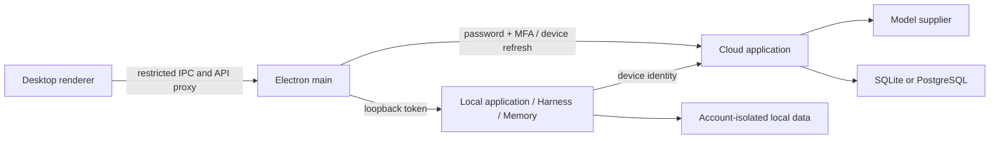

# Architecture

Octop has two independent Python applications and an Electron desktop shell. One wheel contains the application code and a shared React UI; installation extras choose the dependencies. The server is a control plane and model gateway. Agent execution runs on the user's computer.

## Application boundaries

| Application | Composition | Owns | Does not start |
| --- | --- | --- | --- |
| Cloud | `api/applications/cloud.py`, `infra/applications/cloud.py` | Accounts, MFA, devices, resource publication/assignment, model authentication/budgets/settlement, backup storage | Harness, Memory runtime, Browser, Gateway, cron, tools |
| Local | `api/applications/local.py`, `infra/applications/local_accounts.py`, `infra/applications/local.py` | Account selection, resource installation, Harness turns and approvals, local files/memory, durable backup outbox and explicit restore | Legacy server, IM, cron, Bridge, cross-user Agent collaboration |
| Electron | `desktop/src/main/`, `preload/` | Sidecar process, OS credential store, trusted API/WS proxy, updates, suspend/quit ordering | Cloud model supplier credentials |

`launch.py` selects one factory. `octop run` defaults to cloud; `octop run --role desktop` / `octop-local` select the loopback application. Both use one uvicorn worker. Neither assembles `OctopServer`, `AgentManager`, or the legacy `api/app.py`. There is no cloud fallback executor.

The desktop renderer loads `octop://app/` in a sandbox with context isolation. Electron main alone holds the local API token and long-lived device refresh credential. Only main can change the trusted cloud origin, select a cloud account or prepare shutdown. HTTP and WebSocket proxies block those control paths, including encoded spellings. Development UI uses the same proxy boundary. Cloud management browser sessions remain in memory.

## Identity and resources

Password plus TOTP MFA (with recovery codes) authenticates an account. Each user has one current device binding and a generation fence. Replacement or revocation invalidates old device writes and model calls. Account, device and local API credentials have different audiences and cannot substitute for each other.

Platform Agent/skill definitions, immutable revisions, published revisions, device assignments, installation receipts and runtime instances are distinct. Agents pin skill revisions. A device installs a complete verified tree before switching versions, and only at a turn/approval boundary. Platform edits require a personal copy; personal IDs and skill snapshots remain independent of later platform updates.

## Model calls and settlement

All model consumption goes through the cloud gateway. The desktop selects a logical model, never a supplier URL or API key. The gateway validates the current device and Agent/thread/turn relationship, reserves the configured upper bound transactionally, records each supplier attempt, then settles authoritative usage. Idempotent retries do not create another supplier call. Ambiguous outcomes retain a reservation for explicit reconciliation. Currency and rates are configured by the administrator; no production price is assumed.

## Storage and synchronization

Cloud and local migrations are independent under `infra/db/migrations/cloud/` and `local/`, with separate watermarks. Cloud state, encrypted secrets and synchronized content chunks use SQLite or PostgreSQL. No pgvector service is required by the cloud application. Local execution uses SQLite and account-isolated directories selected only after cloud identity verification. See [identity](cloud-identity.md), [model gateway](platform-models.md), [resources](platform-resources.md) and [sync](platform-sync.md) for exact contracts.

Synchronization uploads a versioned projection of messages, tool results, supported files and logical memory. Only `inbound/` and `artifacts/` file contents are exported; external files, hidden/system paths, credentials, browser profiles, execution checkpoints, temporary files and caches are excluded. File chunks are uploaded and verified before publishing references. Durable outbox state and cloud acknowledgement determine success. Offline edits survive restart; restore is explicit and skips agents with pending local changes. No tool or pending approval is replayed during restore.

Suspend and quit close request admission, cancel/drain turns, persist interruption, drain accepted memory work and attempt a bounded final sync. Wake verifies the device before reopening admission. Forced exit recovers durable history as interrupted; it does not resume execution. Tray hiding leaves the application running.

## Source and distribution

The maintained library sources live in `vendor/octop-harness` and `vendor/octop-memory`; `VENDOR.json` records upstream bases. `tool.uv.sources` and `uv.lock` select these paths. Runtime algorithms remain in their owning library, not copied into Octop application modules. Browser remains a separately versioned dependency. Gateway is used only by retained legacy regression modules.

`uv sync --frozen` installs local source dependencies. `make build` builds the UI, Octop wheel/sdist and local library wheels with role-specific locked requirements in `dist/product/`. Install this wheel set together; a bare registry install is not the distribution contract for the locally maintained versions. Portable builds install those same library wheels, not editable source paths. The cloud image installs only `cloud`, copying library metadata solely so uv can read the frozen source records.

Current deployment examples run one cloud gateway. The Helm chart prevents overlapping gateways during upgrades; cloud interruption is handled by desktop pending state. Multi-replica gateway recovery has not been validated. Legacy FnOS native/full-server packages and full/lite execution images are retired. Use the cloud container and a desktop installer.

See [ADR 004](adr/004-local-agent-cloud-control.md), [product setup](product-applications.md), [CLI](cli.md), [API](api.md) and [AGENTS.md](../AGENTS.md). CI defines native Linux/macOS/Windows product and package checks; configured jobs are not evidence of having run them on this workstation.
